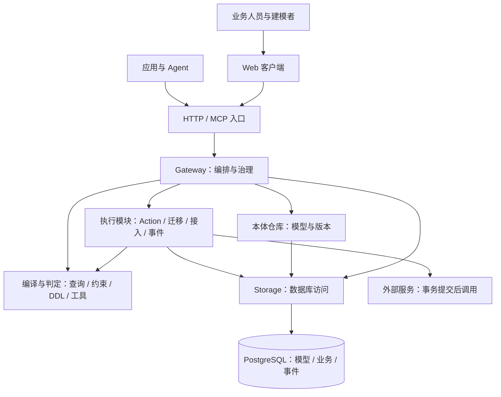
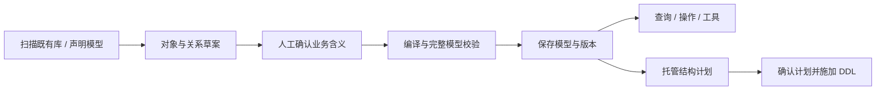
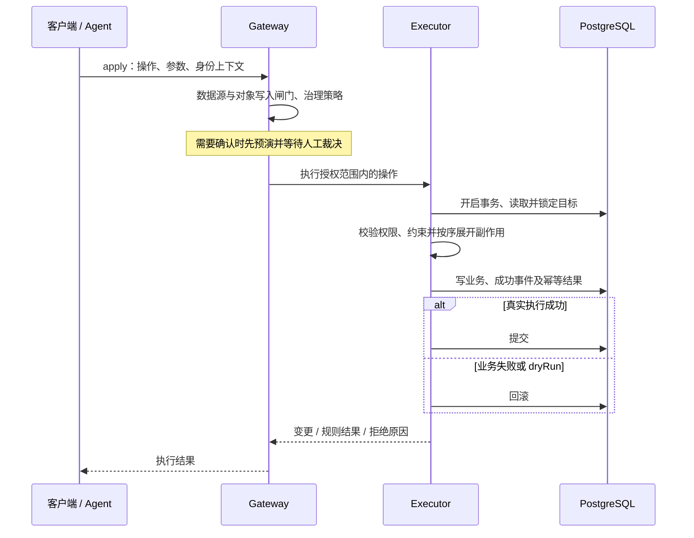

# Autelogy 总体架构

状态：依据技术笔记整理的架构基线，尚未对照应用代码验证。产品目标与验收口径见[PRD](../prd/README.md)。本文保留关键职责、数据流与一致性边界，模块内部实现以代码为准。

## 1. 架构概览

Autelogy 以七原语构成的元模型为核心，将业务定义编译为查询、校验、结构变更计划和 Agent 工具，再由统一执行链处理业务操作。

纯计算与数据库、网络等副作用分开：编译器负责“应该做什么”，执行模块负责“如何真正执行”，网关负责“以什么顺序执行、是否允许执行”。

图中数据库代表逻辑存储类别，不表示所有部署天然共享一个事务。需要原子提交的业务、事件和幂等记录必须处于同一事务可达范围。

## 2. 本体与数据组织

### 2.1 模型层级

`Workspace` 组织一组本体及治理上下文，`Domain` 划分业务领域。七原语使用明确的身份和引用组织定义，`PropertyType` 还需要所属对象或关系的作用域，避免同名属性冲突。

`Datasource` 在工作空间下独立注册，与业务域分开，表达数据在哪里、通过什么通道访问、允许哪些引擎操作。`Actor` 表达谁在执行、代表谁执行，由认证和治理链使用。

### 2.2 七原语的协作

| 原语 | 架构职责 |
| --- | --- |
| `ObjectType` | 定义对象身份、属性集合及数据源绑定 |
| `PropertyType` | 定义类型与存储映射，区分列属性、派生属性和聚合属性 |
| `LinkType` | 定义业务关系、基数与实现，支持外键、连接表和派生关系 |
| `ActionType` | 定义业务写入的参数、顺序副作用、权限要求与风险属性 |
| `Constraint` | 定义值域、状态、关系及操作规则，并指定判定时机 |
| `Function` | 提供无业务写入副作用的计算或读取能力 |
| `Interface` | 通过显式映射统一多个对象类型的查询及操作契约 |

`ActionType` 是业务数据写入的统一通道。模型保存、身份管理和数据库迁移属于各自受控的管理写入，不能据此将所有平台写操作等同于业务 `apply`。

### 2.3 数据源与写入边界

`mode`（`managed`／`external`）与 `channel`（`transactional`／`facts`）是两个独立维度：前者描述管理方式，后者描述数据用途。不能将外部数据源简单等同为任何情况下都只读。

业务写入须同时通过数据源能力与对象级 `engineMayWrite` 白名单；缺少明确授权时拒绝写入。`facts` 通道不作为业务写入目标，具体事实源连接能力另行核实。数据源配置保存环境变量名，实际连接凭据由部署环境提供。

## 3. 模块分层

| 层级 | 模块 | 核心职责 |
| --- | --- | --- |
| `L0` 入口 | `apps/server`、`apps/mcp`、`apps/probe` | 协议适配、请求校验与身份上下文接入 |
| `L1` 编排 | `gateway` | 组织四动词、接入、迁移及治理流程，是统一顺序裁决点 |
| `L2` 执行 | `executor`、`ontology-repo`、`event-store`、`migrator`、`introspect`、`script-runtime` | 执行业务、持久化模型与事件、扫描结构、施加迁移及隔离运行脚本 |
| `L3` 编译与定义 | `schema`、`expr`、`constraint`、`query-compiler`、`ddl-compiler`、`type-mapping`、`ontology-compiler`、`tool-schema` | 共享契约、表达式、规则判定及各类编译，保持零 IO |
| `L4` 存储封装 | `storage` | 统一连接、查询、事务与数据库写能力 |
| `L5` 基础设施 | PostgreSQL | 保存模型、业务数据和治理记录 |

`frontend/` 是网络另一侧的客户端。前端共享契约，不直接依赖后端执行与存储模块。

分层依赖向下，同层复用通过明确白名单管理；不要求所有同层包完全隔离。`executor` 可组合本体、事件、迁移及脚本能力，`ontology-repo`、`event-store`、`migrator` 保持各自职责。跨包通过公开出口使用，数据库驱动集中在 `storage`。

## 4. 对外能力

| 动词 | 作用 | 关键边界 |
| --- | --- | --- |
| `describe` | 描述对象、关系、操作及规则 | 产出可理解的业务说明 |
| `query` | 查询对象、过滤、排序、分页和关系展开 | 编译为参数化 `SELECT`，不能绕过模型执行写入 |
| `apply` | 执行声明的业务操作 | 统一进入权限、策略、约束、事务及审计链 |
| `events` | 读取操作结果、因果链与订阅事件 | 审计记录追加保存 |

四动词是业务运行时主接口；建模、数据源接入、迁移和 IAM 还有专门的管理接口。HTTP 与 MCP 应复用同一网关语义。

`describe` 面向人和 Agent 的阅读，前端模型清单提供结构化定义以生成交互。两者来自同一模型，根据消费者需求投影，避免客户端反向解析文本类型。

## 5. 核心执行链

### 5.1 接入与模型保存

扫描得到的是物理事实，建模者确认的是业务含义。主键、展示属性、关系角色和类型退化需要显式处理。高层草案及 DSL 最终都转换为七原语，再由本体仓库检查引用、表达式、接口映射和循环依赖。

模型保存与 DDL 施加是两个过程。迁移仅支持明确的增量步骤；删除列、改变类型或主键等破坏性操作不自动生成。施加前重新计算计划并比对用户确认的指纹，迁移在数据源范围加锁执行并记录历史。

### 5.2 查询

网关加载模型、解析数据源并调用查询编译器，得到参数化 SQL 或关系展开计划，再通过存储层执行并组装结果。单值关系可使用连接，多值关系采用批量子查询，避免分页被子行放大。

跨数据源关系展开显式拒绝。接口查询将共享属性映射到各实现类型，复用已有查询能力后合并结果；当前笔记中的接口查询不支持游标与关系展开。其他分页、表达式与连接能力也必须按实际支持范围检查，不能静默降级。

### 5.3 业务操作

级联操作共享最外层业务事务，任一阻断错误使全链回滚。角色、对象范围和密钥范围在执行链中校验，子操作不能绕过授权。约束模块只做判定；需要数据库事实时声明探针，由执行器查询并回传。

成功路径将业务变更、事件和幂等结果一起提交。失败后可用独立事务记录拒绝；`dryRun` 在回滚后返回预演结果，不提交业务、事件和幂等记录。只读校验与部署闸门仍须生效。

外部调用在业务事务提交后发出，调用失败单独留痕，不回滚已提交业务。该边界不保证外部服务与数据库原子一致，也不能据此推导出可靠投递或恰好一次执行。

## 6. 治理与审计

### 6.1 身份、策略与确认

业务元模型描述操作本身的可逆性、影响范围、外部副作用及是否允许自动化；网关结合执行者与会话决定是否放行、拒绝或要求确认。

确认链先产生真实预演，再将确认绑定到会话、操作、参数和变更指纹。执行时影响不同则拒绝复用确认。具体对象操作与接口分派后的操作必须进入相同治理链；工具列表过滤不能替代服务端策略。

### 6.2 事件与责任归属

事件记录执行身份、代理责任、模型版本、业务变化与关联上下文，使用 `correlationId` 关联同一次执行，用 `causationId` 重建因果链。审计事件通过数据库约束保持追加式写入，更正用补偿事件表达。

事件订阅须处理事务提交先后与事件编号先后的差异，不能只凭最大编号推进游标。笔记采用事务水位线方案，并要求启动时检查所需可见性。审计可见性与订阅积压应进入运维检查范围。

### 6.3 漂移

结构漂移对比数据源观测结果与接入基线；约束漂移检查当前数据是否满足模型规则。后者没有真实变更前后的镜像，不能直接复用所有同步规则；无法判定、跳过和未扫完的范围都应在结果中显式返回。

## 7. 部署与质量边界

笔记以 TypeScript 工作区、Web 客户端、HTTP 服务、MCP 服务和 PostgreSQL 为基础。各入口通过网关复用执行语义，共享存储时需要处理跨进程模型缓存与版本一致性。

部署必须明确控制数据、业务数据、事件和幂等记录的连接位置：只有实际共用一个事务句柄时，成功路径的原子性才成立。跨数据源级联写入被拒绝。新增数据源能力前，应先证明事务与审计约定仍成立。

验证分两类：编译器和规则使用离线单元测试（`*.test.ts`）；SQL、锁、回滚、幂等和迁移使用真实 PostgreSQL 集成测试（`*.itest.ts`）。还应验证人和 Agent、HTTP 和 MCP、具体对象与接口调用的规则一致性。

本仓库仅含文档。笔记提及的 `pnpm gate`、`pnpm test:it` 等命令，须在实际应用仓库检查脚本后运行。

## 8. 已知限制与后续核实

| 主题 | 当前文档边界 |
| --- | --- |
| 外部副作用 | 提交后调用，不承诺可靠重试、补偿或恰好一次投递 |
| 多数据源 | 可组织多个来源，但不支持跨数据源原子级联与关系展开 |
| 非 SQL 事实源 | 已有模型声明思路，协议和运行时接入未核实 |
| 托管迁移 | 增量计划不等于完整结构同步；已有列类型及可空性比对存在限制 |
| `Function` | 有多种声明形态，不等于各实现均可运行；`query` 及 Python 脚本实现需核实 |
| 关系读写 | 关系可被建模或查询，不代表每种实现均可执行 `link`／`unlink`；笔记阶段间有差异 |
| 数据可见性 | 写入授权不能被解释为完整读取隔离；属性敏感度过滤与读权限覆盖须核实 |
| 人工确认 | 笔记描述令牌在业务事务外消费，执行失败后可能需要重新确认 |

后续以应用代码和端到端验证更新这些边界。生产容量、审计保留周期和部署可用性目标需根据实际环境制定。
