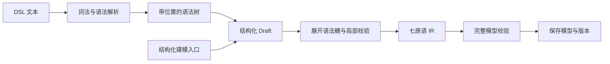

# 编译器：从业务定义到可执行产物

本文解释 Autelogy 的编译链。架构基线来自技术笔记，尚未对照应用代码验证；示例用于解释语义，不作为可直接调用的 API 契约。总体分层见[总体架构](README.md)，运行时见[执行器](executor.md)和 [Function](functions.md)。

## 1. 编译器承担什么职责

平台中有多类编译器，围绕同一套本体定义分别处理建模、查询、建表和工具生成。编译的共同特点是只接收数据、返回结果与诊断，不建立数据库连接、不提交业务变更。

| 编译或检查环节 | 输入 | 输出 | 使用者 |
| --- | --- | --- | --- |
| 本体编译 `ontology-compiler` | DSL、结构化草案、模型上下文 | 七原语实体、诊断、源码位置映射 | 建模入口、本体仓库 |
| 表达式检查 `expr` | 表达式 AST、绑定作用域、只读本体视图 | 类型检查结果与错误建议 | 本体保存校验 |
| 查询编译 `query-compiler` | 本体、查询请求 | 参数化 SQL 或关系展开计划 | 网关、执行器中的只读查询 |
| DDL 编译 `ddl-compiler` | 目标模型、当前表结构 | 增量迁移步骤、指纹、阻断与跳过说明 | 网关、迁移执行模块 |
| 工具编译 `tool-schema` | 本体、工具暴露选项 | 工具定义、未暴露操作、编译问题 | Agent 接入与工具展示 |

`schema` 提供形状与公共契约，`constraint` 提供纯规则判定；它们与编译器协作。运行时判定与编译都属于零 IO 计算，但规则判定会使用本次操作的真实值。

## 2. 先形成统一的中间表示

模型可以来自数据库扫描后的草案、结构化编辑，也可以来自 DSL。各入口最终收敛到七原语，执行器不需要为每种编辑方式建立执行逻辑。



这里的 IR（中间表示）是标准的 `ObjectType`、`ActionType`、`Constraint` 等定义。它保留业务语义，仍需通过本体仓库的完整校验才能保存。

### 2.1 以审批 Action 为例

以下是业务伪代码，表达意图，不要求读者掌握 DSL 语法：

```text
操作：审批订单
参数：订单、审批人
前置条件：订单状态为 submitted
步骤：
  1. 将订单状态改为 approved
  2. 创建审批记录，绑定为 log
  3. 执行后续声明的业务操作
```

编译器将前置条件转换为对应的 action scope `Constraint`，将步骤转换为顺序执行的 effects，保留参数、权限要求及风险声明。引用 `log` 的步骤必须位于创建它的步骤之后。

编译器检查绑定的出现顺序、名称冲突与循环体作用域，避免“全局上有这个名字，执行到这里时却还不存在”。`for_each` 循环内绑定不能泄漏到外层；循环体内不能嵌套 `for_each` 或执行 `call_external`。

### 2.2 编译成功与保存成功

局部编译可以确认一个步骤形状合法，但完整模型还需要回答：引用的对象是否存在、字段类型是否兼容、接口映射是否完整、Action 调用图和接口继承图是否成环。

因此装配后的实体先使用公共 schema 校验，再在保存事务中合并到当前模型执行引用和语义检查。编译结果不能绕过最终保存校验。诊断保留字段路径或源码范围，让编辑器能将错误定位到原输入。

## 3. 表达式如何检查与求值

表达式以 `ExprNode` AST 表达常量、引用、比较、算术、逻辑和函数调用。DSL 文本先解析为 AST；运行时不将用户字符串交给通用 `eval`。

检查阶段使用只读本体视图与作用域，解析 `target.status` 等路径，推导属性和关系导航结果的类型，再检查算子与函数参数。例如，将金额字段与文本比较，或引用拼错的 `target.amoutn`，应在保存模型时拒绝。

求值阶段使用真实参数、对象镜像、执行者和必要的预计算结果。检查与求值共享类型规则和内置函数定义，避免两套语义独立演进。

有三项重要约定：

- 空值有明确的传播与逻辑语义；SQL 下推必须逐算子与内存求值对齐，不能把所有比较机械翻译为 SQL 符号。
- `decimal` 与大整数的比较不能靠普通 JavaScript `Number` 转换，金额或大主键不能因精度丢失而判错。
- 一次 Action 的 `now()` 使用注入的共同时间，避免同一操作内多个时间判断互相矛盾。

## 4. 查询如何变成 SQL 与计划

### 4.1 属性名到物理存储的映射

调用方使用本体属性名，编译器根据 binding 找到物理表列。列属性直接引用存储列；派生属性转换为受支持的 SQL 表达式；聚合属性转换为相关子查询。

例如“查询已提交订单的编号和金额”，可形成如下示意产物：

```sql
SELECT "po_id" AS "id", "total_amount" AS "amount"
FROM "business"."purchase_order"
WHERE "status" = $1
ORDER BY "po_id"
LIMIT $2
```

```json
["submitted", 100]
```

值放入参数数组，表名、列名等标识符独立引用转义。SQL 产物只有 `SELECT`；编译完成后由有 IO 能力的调用方选择连接并执行。

### 4.2 关系展开需要执行计划

查询“供应商及其订单”时，一个供应商可能对应多张订单。直接 JOIN 后分页会让子行占用父对象的页大小。编译器因此按基数选择执行策略：

| 关系结果 | 编译策略 | 目的 |
| --- | --- | --- |
| 一个或零个对象 | 使用 `LEFT JOIN` | 保留没有关联对象的父行 |
| 多个对象 | 先查父对象，再按父键批量查子对象 | 保留父对象分页，避免逐父查询 |

计划包含 SQL、父键参数位置和结果拼装信息。网关负责先执行父查询、填入子查询所需父键并组装嵌套结果。查询深度、扇出与分页限制需要显式检查，不能静默截去数据。

### 4.3 表达式可求值，不代表能下推

派生属性中的表达式下推只覆盖笔记已描述的子集：同行列引用、受支持的内置调用，以及可递归内联的 `expression` Function。跨关系引用、嵌套派生／聚合，以及脚本、外部或 `query` 实现的 Function，不应假定能编进 SQL。

接口查询通过映射共享属性到具体实现者并复用查询编译，合并结果由网关负责。跨数据源展开、接口查询中的游标与展开等限制见[总体架构](README.md)。

## 5. 规则如何与编译产物协作

十二类规则覆盖三组需求：

| 分组 | 规则 | 运行时输入 |
| --- | --- | --- |
| 值域 | `required`、`range`、`length`、`regex`、`enum_member` | 本次变更中的属性值 |
| 数据库事实 | `unique`、`cardinality`、`referential_integrity`、`acyclic`、`rate_limit` | 执行器取回的查询事实 |
| 状态与表达式 | `state_machine`、`expression` | 变更前后镜像及表达式绑定；表达式还可能需要聚合或 Function 结果 |

同一规则可以产生多个用途的产物：保存时检查定义，写入时判定实际值，适合下推时增加数据库约束，生成工具时说明限制。各用途覆盖范围不同，不能把工具参数校验或数据库 CHECK 视为完整业务规则。

判定结果包含 `pass`、`fail`、`need_facts`、`engine_fault`。需要事实时，纯判定模块声明 probe，执行器查询并回传，再继续判定。具体循环见[执行器](executor.md)。

## 6. 模型如何变成数据库结构

DDL 编译器接收目标模型和当前物理结构，返回结构化迁移计划。当前笔记描述的步骤包括 `create_table`、`add_column`、`add_check`、`add_unique` 和 `create_index`，不包含删除列或改变列类型。

新表路径会编译物理列、主键及可下推约束，派生和聚合属性不生成物理列。关系连接表可使用两端引用和关系属性建立结构。已有表路径主要检查列的增量变化，不能将空计划理解为类型、可空性和约束均已完全一致。

数据库约束下推覆盖可支持的 `range`、`enum_member` 和无条件 `unique` 等情形，其他规则保留在运行时执行，并列出跳过原因。列的非空性由属性定义处理，不与所有业务必填场景混同。

计划带顺序敏感的指纹。用户确认后，网关重新读取现状并计算计划，迁移模块比对指纹、加锁、施加 DDL 并记录历史。编译器本身不承担数据库迁移事务。

## 7. 模型如何变成 Agent 工具

工具编译器将可暴露的 Action 转换为名称、说明和输入 schema，同时提供权限、风险和未编码约束等元信息。说明应让 Agent 知道操作做什么、前置条件是什么、还会影响哪些对象。

当前笔记中的工具参数 schema 只覆盖部分规则。未纳入 schema 的约束通过 `unmodelledConstraints` 保留，避免 Agent 误认为通过参数检查就一定能执行成功。这里描述的是本平台的编译选择，不代表所有模型服务都具有相同的 schema 限制。

`automatable: false` 的操作可以不生成 Agent 工具，但服务端仍必须拒绝不允许的自动化调用。未暴露的操作放入 `withheld` 并给出原因；编译问题通过 `problems` 可见，不应只写日志后悄悄少一个工具。

工具说明对 `for_each`、`call_external` 等后续加入的效果是否覆盖完整，笔记已有缺口提示；接入代码时必须核实。Function 是否以独立只读工具暴露也需检查真实入口，不能从其模型定义直接推导出完整可用工具。

## 8. 一条完整业务链

采购域先将“订单、供应商、审批规则”保存为七原语。查询编译器用它生成订单查询；工具编译器用它生成审批工具。Agent 选择工具后，网关校验策略，执行器读取订单并判定审批规则，其中 Function 或聚合所需事实由执行器取得。通过后在事务中写订单、审批记录和事件。

模型保持同源，但 SQL、工具定义、运行时判定和迁移计划各有独立职责与支持范围。验证重点是跨产物语义一致、非法输入可定位，以及任何编译或检查失败都不能被解释为已执行成功。
