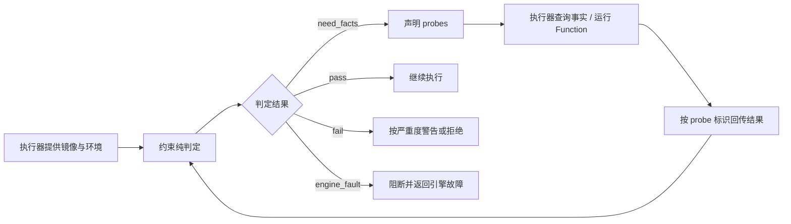

# 执行器：让业务操作在规则与事务中完成

本文说明 `executor` 如何执行一次 Action，以及它与网关、约束模块和 Function 的分工。内容来自技术笔记，实际顺序和能力覆盖需对照代码验证。参见[总体架构](README.md)、[编译器](compiler.md)和 [Function](functions.md)。

## 1. 输入、上下文与结果

执行器接收已解析的 Action、参数、本体快照、执行者与授权上下文，以及事务所需的存储能力。`dryRun`、幂等键和 `expectedChanges` 等选项控制预演、重放与条件执行。

输出包括执行是否成功、对象变化、约束结果、事件与调用信息，或结构化拒绝原因。业务失败通过结果返回，调用方应区分可修改输入的拒绝、执行护栏和引擎故障。

| 模块 | 负责的决定 |
| --- | --- |
| 网关 `gateway` | 加载模型与授权数据，选择数据源，判断部署写能力和自动化策略，组织确认流程 |
| 执行器 `executor` | 绑定真实对象，执行权限与约束检查，按序运行 effects，管理业务事务与级联 |
| 约束模块 `constraint` | 对给定值和事实做纯判定，缺事实时声明 probe |
| 存储层 `storage` | 提供连接、事务与数据库访问，不理解业务操作语义 |
| 事件模块 `event-store` | 使用调用方事务追加事件，维护审计与归属信息 |

网关允许进入执行流程，不等于所有运行时权限和业务规则已经通过。后续级联同样需要校验，不能只检查最外层 Action。

## 2. 一次 apply 的生命周期

下表描述职责上的处理阶段；角色检查、绑定和幂等命中等短路点以具体执行入口为准。

| 阶段 | 主要处理 | 必须成立的条件 |
| --- | --- | --- |
| 请求准备 | 解析操作、参数、执行者与授权上下文 | 请求指向确定的模型和业务范围 |
| 重放检查 | 查找可复用的幂等结果 | 命中后不重复产生业务变更 |
| 事务与绑定 | 进入业务事务，读取目标及 `object_ref` 参数 | 对象绑定到真实数据，必要时使用 `FOR UPDATE` |
| 授权与护栏 | 检查角色、对象范围、密钥范围及级联状态 | 当前层和子层都在允许范围内 |
| 前置检查 | 运行 `pre_effect` 约束 | 不满足前置条件就不展开副作用 |
| 副作用展开 | 按声明顺序修改、创建、删除、关联或调用子 Action | 后一步能读取前一步产生的绑定 |
| 事务内复核 | 运行 `pre_commit` 与 `in_tx_post`，核对变更指纹 | 最终状态与用户批准的影响仍然一致 |
| 形成结果 | 汇总变化与事件 | 成功事件和幂等结果搭乘同一业务事务 |
| 完成事务 | 提交，或因失败／预演回滚 | 失败时不保留半条业务链 |
| 提交后工作 | 执行声明的外部调用，记录结果 | 外部失败不伪装成数据库已回滚 |

笔记中的业务事务采用 `REPEATABLE READ`，使同一次执行中的多次读取基于一致快照，并能看见自己的写入。锁、数据库约束及并发冲突处理仍须单独验证，不能仅凭隔离级别承诺所有并发不变量自动成立。

## 3. 对象与表达式环境如何绑定

调用方传入对象引用时，通常传的是对象主键。执行器需要读取那一行，形成属性值视图，表达式才可以求值 `target.status`、`order.amount` 等路径。

环境还包含普通参数、执行者、共同时间，以及前面 effects 创建并命名的对象。规则的上下文按作用域区分：

| 规则上下文 | 可使用的信息 |
| --- | --- |
| 属性／对象变更规则 | `before`、`after`、`target`、`actor` 等变更上下文 |
| Action 规则 | 当前 Action 的参数、目标、执行者及当时已经存在的步骤绑定 |
| 接口级操作 | 通过映射形成的共享属性视图，及实际的具体对象身份 |

创建没有真实的 `before`，删除没有真实的 `after`。规则不能把“没有该镜像”当作“镜像里某个字段为空”。前置条件也不能引用尚未执行的创建步骤。

## 4. Effects 如何执行

Action 的副作用是受支持操作的封闭集合，并按声明顺序执行。

| 副作用 | 执行含义 | 关键限制 |
| --- | --- | --- |
| `set_fields` | 修改对象的可写属性 | 派生或聚合属性不能当物理列写入 |
| `create_object` | 创建对象，可绑定结果供后续步骤引用 | 主键生成方式须与模型及物理结构一致 |
| `delete_object` | 删除对象 | 遵守关系与级联规则 |
| `link`／`unlink` | 建立或移除关系 | 各种关系实现的写入覆盖须核实；派生关系只读 |
| `call_action` | 进入子 Action | 复用外层事务、身份与全链护栏 |
| `emit_event` | 形成声明的业务事件 | 随整个业务事务提交 |
| `for_each` | 对一组输入逐项运行受限步骤 | 不能嵌套循环或在循环体内调用外部服务 |
| `call_external` | 记录待发出的外部调用 | 事务内不发请求，提交后才执行 |

不能把全部 effects 并行执行：后面的参数和表达式可能依赖前面新建的对象。不能将脚本 Function 当作另一种写入通道，所有业务写入仍通过 Action。

## 5. 约束如何取得事实并完成判定

### 5.1 四个判定时机

| 时机 | 检查内容 | 典型用途 |
| --- | --- | --- |
| `pre_effect` | 展开副作用之前的 Action 条件 | 订单必须已提交 |
| `pre_commit` | effects 完成后的事务内结果 | 对象状态与业务表达式检查 |
| `in_tx_post` | 写入后的事务内事实 | 关系图不能产生环 |
| `async_drift` | 独立扫描当前已存在的数据 | 发现外部写入或模型调整后的规则漂移 |

前三种是同步执行链的一部分；`async_drift` 是独立治理流程，不能阻断已经提交的操作，也不具有一次真实变更的完整镜像。规则时机与作用域必须合法组合，例如 `pre_effect` 只用于 Action scope，`acyclic` 只能在 `in_tx_post` 检查，`async_drift` 只能采用 warning 级别。

### 5.2 Probe 循环

例如，唯一性需要查询是否存在冲突对象，操作频率需要读取成功事件计数，表达式里的 `sum` 或自定义 Function 也可能需要运行时事实。约束模块不自己连接数据库，而是把需求交给执行器。

事实按 probe 标识对齐并累积，笔记描述的循环上限为两轮；仍无法得到完整事实时视为引擎故障。缺事实不能当通过。warning 进入结果与事件，error 违反和引擎故障阻断执行。

## 6. 级联与批量为何能整体回滚

只有最外层调用建立业务事务，子 Action 使用同一个事务句柄。子层产生的变更与事件向外汇总，全部完成后由最外层决定提交。任一层失败，都回滚整条链。

级联同时需要静态和动态检查：保存模型时检查调用图，运行时根据实际对象检查重入、深度和累计扇出。检查的是 Action 与对象身份的组合，不能把对不同对象执行相同操作一概当作循环。

笔记描述的运行时基线如下，接入代码时须核实常量与可配置性：

| 护栏 | 基线限制 |
| --- | --- |
| 调用深度 | 最多 8 层 |
| 全链 effects 数量 | 最多 1000 |
| 单次 `for_each` 输入数 | 最多 500 项 |
| 重入 | 同一关联执行中重复进入同一 Action 与对象组合会被拦截 |
| 数据源 | 不允许跨数据源级联写入 |

全链计数共享，不能每层单独重置。输入数量过大可要求缩小批次；调用形状导致的深度、重入等问题则需要建模者处理。它们的反馈不应混成一种错误。

## 7. 预演、确认与条件执行

`dryRun` 运行真实的绑定、规则和事务内副作用，收集变化后主动回滚，在写入成功事件与幂等记录之前结束。它返回“当前状态下会发生什么”，不提交业务结果，也不模拟调用外部服务。

因此预演是一次实际执行过程，可能读取和锁定业务对象，应受到与正式执行一致的授权和资源限制。它不能证明未来重试时数据仍相同。

治理层需要人工确认时，先取得预演，再将确认绑定到会话、Action、参数指纹与变化指纹。正式执行重新计算实际变化，在同一业务事务内比较 `expectedChanges`，不一致则回滚并要求重新预演。

笔记中的确认令牌在业务事务外消费，选择了避免重复放行的方向；代价是业务执行失败后也可能需要重新确认。确认不替代角色与对象范围授权。

## 8. 三类完成路径与外部调用

| 路径 | 业务数据 | 事件与幂等 | 外部调用 |
| --- | --- | --- | --- |
| 正式执行成功 | 提交整条链 | 成功事件与幂等结果同事务提交 | 提交后发出 |
| 正式执行被拒 | 回滚整条链 | 回滚后另开事务记录拒绝，不形成成功结果 | 不发出 |
| `dryRun` | 回滚整条链 | 不提交执行事件与幂等结果 | 不发出，不模拟结果 |

拒绝记录使用第二个事务，因此业务回滚与拒绝留痕之间存在失败窗口；第二事务失败需要可观测。外部调用则存在“数据库已提交，外部尚未完成”的窗口，当前架构不承诺可靠投递或外部恰好一次执行。

幂等重放用于避免同一业务请求重复生效。并发同键请求最终竞争唯一记录，败者应回滚自身事务并读取胜者结果，不多留一条业务拒绝。幂等覆盖范围、键冲突和并发故障行为仍需真实数据库测试验证。

## 9. 失败如何对调用方解释

| 结果类型 | 含义 | 合理的处理方式 |
| --- | --- | --- |
| `Rejection` | 违反业务规则、参数或状态条件 | 根据 `hint`、字段路径和当前状态决定是否调整后重试 |
| `GuardrailTripped` | 深度、重入或累计扇出等执行结构触及护栏 | 交给建模者检查调用形状，避免自动重复提交 |
| `EngineFault` | 数据访问、求值或不支持的执行能力等引擎侧问题 | 排查服务或模型配置，不能暗示业务参数一定有错 |

“可重试”表示存在可调整输入或状态的路径，不代表原样无限重试。客户端应保留完整约束结果，避免将无权限、条件变化或引擎故障统称为“审批失败”。

验证执行器需要真实数据库：检查成功与失败后的实际行和事件、并发幂等、级联回滚、确认后数据变化、Function 故障以及外部调用失败，不能只断言响应中的成功标记。
