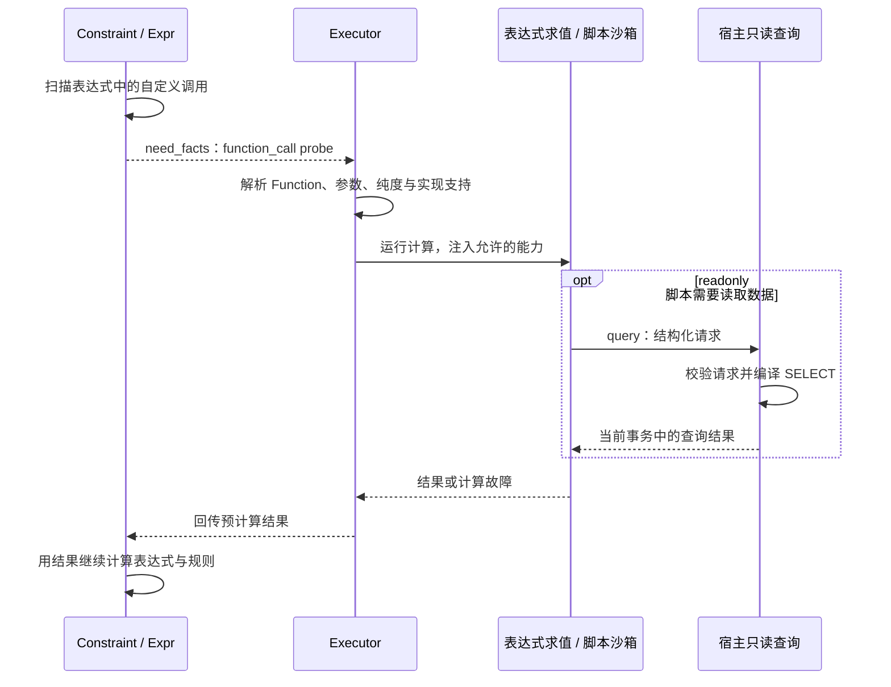

# Function：业务计算如何运行

本文解释本体原语 `Function` 的作用、检查与运行过程。内容依据技术笔记，尚未对照代码验证；独立调用入口和未明确覆盖的实现须另行核实。相关文档：[编译器](compiler.md)、[执行器](executor.md)、[总体架构](README.md)。

## 1. Function 在平台中的位置

`Function` 封装不改变业务状态的计算或读取，例如判断订单是否满足审批条件、计算业务指标、从已有对象中取得只读结果。需要修改订单、创建记录或发起有业务副作用的外部操作时，应定义 `ActionType`。

Function 的返回结果可以参与表达式和约束；实际如何调用由消费它的执行入口决定。笔记明确描述了通过执行器的 `function_call` probe 路径运行自定义 Function，不足以证明已有通用独立调用 API 或所有 Function 都会自动成为 Agent 工具。

| 概念 | 处理的问题 | 能否改变业务状态 |
| --- | --- | --- |
| 内置函数 | 表达式中的基础运算，如 `contains`、`now` | 不能 |
| 本体 `Function` | 带业务身份、参数及返回类型的可复用计算 | 不能 |
| 派生／聚合属性 | 对象上的一个可读取属性值 | 不作为直接写入目标 |
| `ActionType` | 有授权、约束和审计的业务操作 | 可以，通过执行器完成 |

重复调用不修改业务状态，并不等于每次返回值相同。依赖当前数据或外部读取的计算，结果仍可能随环境变化。

## 2. 定义包含哪些信息

Function 需要表达身份、业务说明、参数及返回类型、实现方式、`purity` 和确定性等信息。模型检查据此判断引用是否合法、调用参数是否匹配，以及实现声明是否自相矛盾。

### 2.1 pure 与 readonly

| 纯度 | 数据访问能力 | 适用场景 |
| --- | --- | --- |
| `pure` | 不授予本体查询能力，使用参数完成计算 | 对给定输入做格式处理、业务计算或判断 |
| `readonly` | 可在受控入口中读取本体，不能写入 | 根据当前业务数据计算只读结果 |

纯度限制由运行环境提供的能力落实。脚本声明为 `pure` 时，不注入 `query`；声明为 `readonly` 时，才注入宿主提供的只读查询函数。纯度也不能替代读权限检查，宿主查询入口仍须核实可见范围。

### 2.2 确定性与缓存

`deterministic` 表达对结果稳定性的声明，缓存声明必须与之兼容。笔记中的模型规则拒绝给非确定性 Function 开启缓存，拒绝将 `external` 声明为确定性，也不允许 `query`／`external` 实现标为 `pure`。

这些是模型合法性要求。不能仅凭声明字段就认为生产中已实现跨请求缓存、版本失效或依赖数据失效；缓存执行机制和作用范围需在代码中另行验证。运行时的 `precomputed` 表只承接本次表达式需要的计算结果，也不等同于业务缓存。

## 3. 四种实现的运行边界

| 实现方式 | 运行思路 | 笔记支持口径 |
| --- | --- | --- |
| `expression` | 以表达式 AST 描述计算，由 `expr` 求值 | 已描述明确运行链，不需要脚本沙箱 |
| `script` | 将脚本函数体、参数及能力放入隔离环境 | 已描述 JavaScript 沙箱链；Python 实现未支持 |
| `query` | 声明一种查询实现 | 形状存在，但笔记明确为未实现分支，应显式拒绝 |
| `external` | 表达外部只读计算或读取 | 定义存在，具体适配、授权和执行覆盖需核实 |

`external` Function 与 Action 的 `call_external` 是不同机制。后者具有副作用，在业务事务提交后执行；前者不能借“函数调用”之名承担业务写入。

## 4. 从模型检查到运行时求值

### 4.1 保存时检查调用

表达式检查器通过只读本体视图找到 Function，校验参数和返回类型，并检查调用所在的表达式是否类型兼容。错误的参数类型或不存在的函数应在模型保存时被发现。

高层编译器提供可读诊断，标准 schema 和本体仓库继续负责最终合法性。定义可以被保存的形态不一定已经有运行时实现，因此执行阶段仍需检查支持状态。

### 4.2 执行时通过 probe 取得结果



`findUserFunctionCalls` 找出表达式中的自定义调用，`findPushdownCalls` 找出 `sum` 等需要另行求值的调用。它们可以位于复杂表达式任意深度，不能只看表达式的根节点。

执行器取得结果后，按照调用表达式的标识组成 `precomputed` 表。求值器在走到调用节点时使用该结果，然后继续比较、算术或逻辑运算。数据库和沙箱能力留在执行层，纯表达式求值器保持零 IO。

## 5. expression Function 如何运行

表达式实现直接使用已有 `expr` 求值能力：绑定参数、计算 AST、返回值。它不需要为一次简单计算建立脚本隔离环境。

例如，概念函数 `needs_manual_review(amount, limit)` 返回金额是否超过人工复核阈值。Function 返回的是判断结果；由调用它的约束决定是否阻断，由 Action 决定是否真正修改状态。

表达式中的引用、空值、十进制比较和共同时间，遵循平台统一语义。只有支持的表达式子集可以被查询编译器内联为 SQL；同一 Function 能在运行时求值，不代表它可出现在任意查询过滤或派生属性中。

## 6. script Function 如何运行

脚本实现适合难以用表达式表达的计算，例如有限循环、分组或业务算法。受限表达式本身保持封闭，脚本的计算能力通过独立沙箱承载。

### 6.1 参数与能力注入

`script-runtime` 接收函数体源码、参数、时间／内存配额，以及可选的 `query` 能力。它不负责识别当前业务模型，执行器负责根据 Function 定义决定传入什么能力。

以下仅展示能力形态，示意中的查询请求格式以真实契约为准：

```javascript
// pure：使用注入的 args 计算，不具有本体 query 能力。
return args.actual > args.limit;
```

`readonly` 脚本可以 `await query(request)`。此处 `query` 是宿主闭包，先校验结构化请求，再经查询编译器产生 `SELECT`，使用当前执行上下文的事务读取数据。脚本不获得数据库连接、任意 SQL 或写方法。

### 6.2 隔离与资源控制

沙箱使用 `isolated-vm` 的隔离堆运行脚本，通过复制值和受控桥接与宿主通信。宿主查询异常转换为结构化失败，再在脚本侧形成可捕获异常，避免宿主回调异常直接破坏服务进程。

运行配额同时覆盖同步脚本执行和整个调用的实际经过时间。仅限制同步片段无法约束反复 `await query()` 的异步循环，因此还需要宿主超时守卫，到期终止隔离环境；内存配额限制计算资源占用。

沙箱不提供业务写入能力，也未提供调用另一个脚本 Function 的独立桥接接口。隔离与超时是必要运行边界，具体运行时暴露能力仍应以代码和测试验证。

## 7. Function 如何影响 Action

假设采购审批规则要求“订单必须已提交，并且风险评估满足策略”。这是组合场景示例，不表示已有同名预置业务模板。

1. 建模者定义风险计算 Function，并在审批约束的表达式中调用。
2. 保存模型时检查函数引用、参数及表达式结果类型。
3. 执行审批时，执行器绑定订单与参数。
4. 约束模块提出 `function_call` probe，执行器运行对应实现。
5. 若 Function 返回可计算结果，规则继续判定；是否通过由约束决定。
6. 若 Function 超时、抛错或实现不支持，执行器阻断操作并回滚，不把故障转换为“风险通过”或普通业务不满足。

`dryRun` 中 Function 同样会真实计算，readonly 脚本也可能真实查询；回滚只表示不提交业务变化，不表示跳过计算。脚本的资源和读权限边界仍要生效。

## 8. Function 的产品与验证要求

建模界面应明确参数、返回类型、纯度、实现支持状态和故障信息。若将 Function 暴露为 Agent 只读工具，还应明确其数据范围、资源限制和独立调用契约；这一产品入口不能由架构文档假定已交付。

验证至少包括：参数与返回类型契约、`pure` 无法查询、`readonly` 不能写入、宿主查询失败、同步与异步死循环、内存超限、不支持实现被拒绝，以及 Function 失败时整条 Action 的回滚。readonly 查询的权限覆盖和高精度数据经过脚本后的行为也需单独验收。
